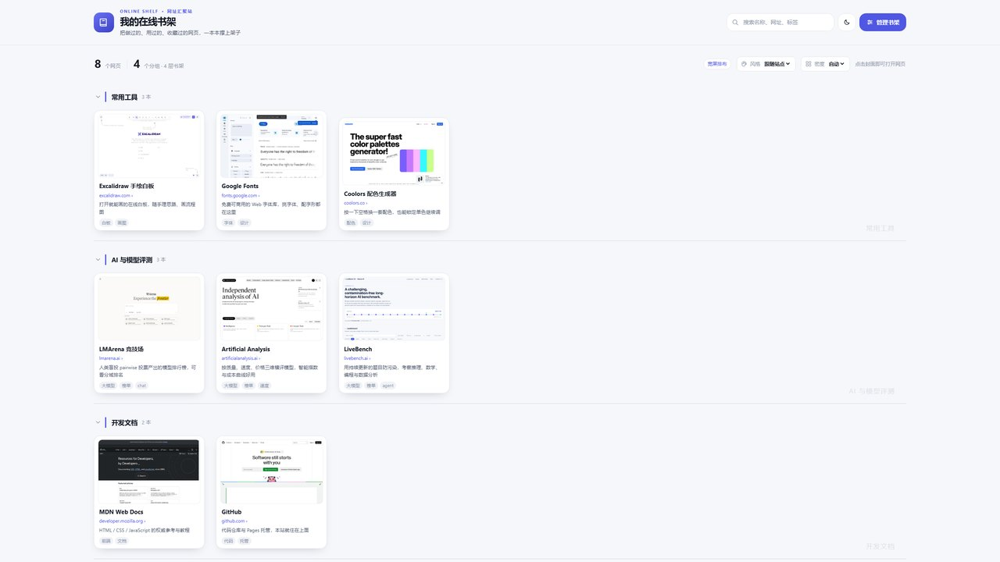

# my-web-shelf

把自己的在线网页摆进一个公开书架：封面是会自动刷新的网页截图，点一下就跳到目标网页。
**纯静态 · 零构建 · 零后端 · 无追踪**，放进 Public 仓库、打开 GitHub Pages 即可公域访问。



## 能做什么

- **实时截图封面**：Microlink → mshots → thum.io 依次回退，全失败才显示域名字母封面；也可上传本机截图内嵌进数据文件
- **浏览器里直接改**：增删网页、改名称 / 网址 / 说明 / 标签；网址加 `?edit=1` 可直接进编辑模式
- **拖拽排序与分组**：卡片拖动换序、跨层换组，分组可折叠 / 重命名 / 排序
- **5K 宽屏**：按视口自动分档放大整套界面，默认密度「紧凑」，另有「密度」下拉与 `?density=xl`
- **五套皮肤**：实木书架 / 极简画廊（默认）/ 暗夜玻璃 / 杂志纸刊 / 复古终端；`styles.html` 可并排试用
- **搜索与明暗**：按名称 / 网址 / 说明 / 标签实时过滤，浅色深色切换

## 部署

1. 新建 **Public** 仓库，把文件上传（或 `git push`）；不要勾选 *Add a README*，避免和本地文件冲突。
2. **Settings → Pages** → Source 选 *Deploy from a branch* → `main` / `root` → Save。
3. 等 1–2 分钟，访问 `https://<用户名>.github.io/<仓库名>/`。

最小上线只需 5 个文件，`assets/skins.css` 不能漏（漏了会退回木质样式）：`index.html`、`assets/app.css`、`assets/app.js`、`assets/skins.css`、`data.json`。

其余可选：`README.md` + `docs/preview.jpg`（本页预览图）、`styles.html` + `docs/skins/`（皮肤对比页）、`tools/sync-seed.py`、`.nojekyll`、`.gitignore`。`data.json` 默认是 8 个示例网址，换成自己的即可。

## 日常使用

点「管理书架」→「添加网页」，填名称、网址、说明、标签、分组与封面方式；点卡片可编辑，卡片右上角按钮可打开 / 移动 / 删除。编辑模式下拖卡片换序、拖到别的层换组，分组标题上的手柄排序、小箭头折叠。

> 改动只存在**当前浏览器的草稿**里，访客改不到你的仓库。要对公域生效：用「导出 data.json」提交到仓库，或用「发布到 GitHub」直推（需 Contents 读写权限的 fine-grained token，令牌只存本机；fork 后改一下所有者和仓库名两格）。

`data.json` 是唯一数据源：`settings` 放标题、首选截图服务、刷新周期、默认皮肤 `skin` 与默认密度 `density`；`groups[]` 每层一个分组，`items[]` 的顺序就是书的摆放顺序。改了 `skin` / `density` 后跑一次 `python tools/sync-seed.py`，同步 `index.html` 首屏属性，避免闪烁。

优先级：**网址参数**（`?skin=` / `?density=`）＞ **访客本机下拉** ＞ **站点默认**（`data.json`，需发布才对公域生效）。本机下拉选「跟随站点」即回到默认。

## 本地预览

```bash
python -m http.server 8000
```

打开 `http://localhost:8000`，皮肤对比页是 `/styles.html`。直接双击 `index.html` 会读内嵌的 seed 数据，改完 `data.json` 跑一次 `python tools/sync-seed.py` 即可同步。

## 常见问题

| 现象 | 处理 |
|---|---|
| 封面只剩域名字母 | 截图服务限流或目标站拒绝抓取；点「刷新预览」，最省事是上传本地截图 |
| `iframe` 模式一片空白 | 目标站禁止被嵌入（`X-Frame-Options`），改用自动截图 |
| 发布报 401 / 403 / 404 | 令牌无效或没给 Contents 读写权限；仓库名、分支（应为 `main`）、路径填错 |
| 提交后线上没变 | 等 Pages 构建 1–2 分钟并强制刷新；本机点「放弃改动」清掉草稿 |
| 换皮肤没反应 | 确认 `assets/skins.css` 已上传；去掉网址里的 `?skin=` 参数 |
| 默认外观 / 密度首屏闪旧样式 | 跑 `sync-seed.py` 后，把更新后的 `index.html` 一起提交 |
